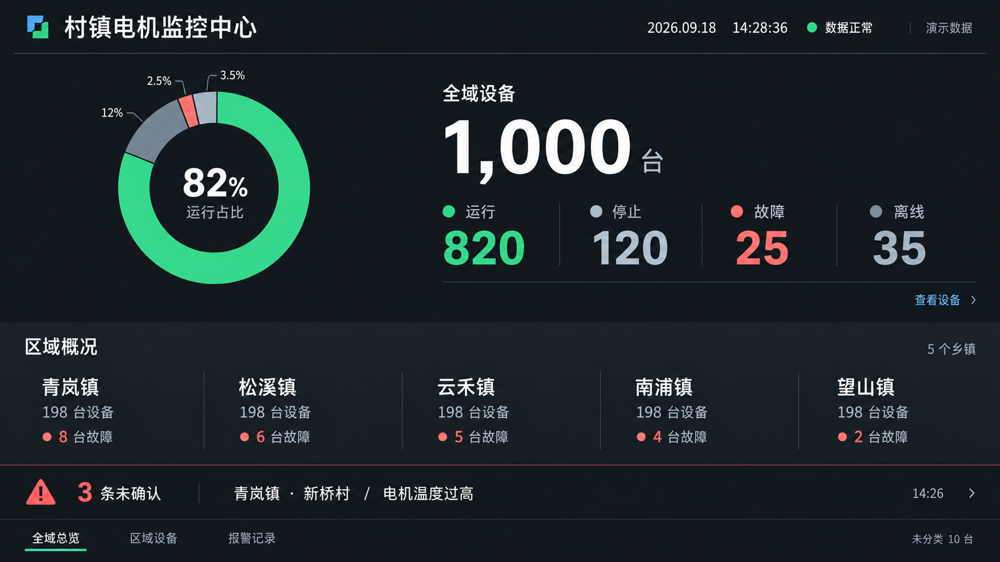

# 大屏主界面视觉审查

> 历史讨论稿：其中关于固定报警区、不引入地图等建议已被后续方案更新。开发请以根 README、V3.0 说明及当前 Demo 为准。

审查对象：本轮重新打开检查的深色静态设计稿。不是已实现应用的交互审计。

## 查看步骤与结论

1. 全域概况：需重构。82% 环图与 820 台重复；1000 台库存总量占据最大字号，异常退居次位。运行占比不能等同健康程度。
2. 区域概况：需精简。五个 198 台重复形成报表节奏；应优先显示区域名称、故障和数据异常状态。无异常时显示简洁正常标记，详细设备数量进入区域页。
3. 报警与导航：部分可保留。固定报警区有价值，但重要性低于大环图；应固定呈现最高优先级未确认报警，最新消息不得覆盖更重要的报警。保留其他报警数量和明细入口。

## 视觉与可读性

主视觉分散于环图、总数、四项状态和五组区域数字。减少重复统计比更换主题色更重要。深色本身不是问题，过大的绿色面积削弱异常辨识。文字标注值得保留，不应仅靠颜色。环图细小百分比、底部低对比文字存在远距离可读风险。

## 建议结构

- 顶部：名称、时间和明确的数据更新时间；通信连接与数据新鲜度分开表述。
- 主体：一句真实状态摘要，例如“3 条报警待确认”；故障设备数、离线设备数作为独立次级指标，不相加为所谓异常总数。
- 区域：乡镇名称及异常提示；不显示重复库存数量，不引入地图范围。
- 底部：最高优先级报警的位置和事件，其他待确认数量，详情入口。
- 正常、故障、数据过期三种状态分别设计；数据过期时不能继续显示“全部正常”。

## 参考与适用范围

- Rockwell HMI Style Guide 第 7–8 页：逐级展开，一级总览突出需立即关注的信息。参考层级与异常提示，非照搬流程工艺图。
  https://literature.rockwellautomation.com/idc/groups/literature/documents/wp/proces-wp023_-en-p.pdf
- Grafana dashboard best practices：仪表盘回答明确问题，减少认知负担；异常定位不需要展示所有数据。
  https://grafana.com/docs/grafana/latest/visualizations/dashboards/build-dashboards/best-practices/
- ThingsBoard Smart Irrigation：区域总览、区域详情、报警面板分别组织。仅借鉴层级，不将地图或控制纳入本项目。
  https://thingsboard.io/use-cases/smart-irrigation/

## 验证限制

此轮为单张设计稿审查与官方案例资料研究；未验证键盘操作、交互流程、实际屏幕距离、字体对比数值、动态报警或真实数据语义。没有修改业务代码，也没有确定接口。
